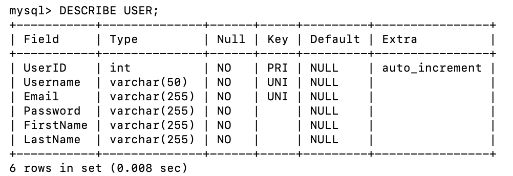
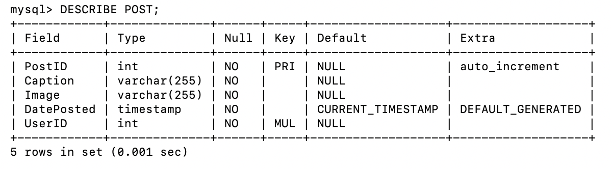
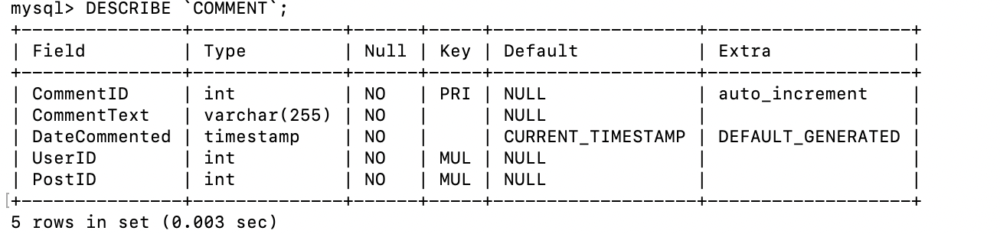

My project will be a social media app.
This app will allow users create a profile. Then with that profile 
they can post pictures with captions. They will also be able to
comment on other peoples posts.

This app will be inteded for anyone who has pictures they wanna share or
look at other peoples posts.

Users will be able to make a username and password. THis will give them their profile. 
With this they can make their own posts or comment on other peoples posts.

## Database Implementation

For this project, I used MySQL to create and manage the database for my social media application. I created three tables: USER, POST, and COMMENT.

### Database Tables

- **USER:** Stores account information such as username, email, password, first name, and last name.
- **POST:** Stores posts created by users, including captions, images, and the date posted.
- **COMMENT:** Stores comments made by users on posts, including the comment text and date commented.

### Table Relationships

The USER and POST tables have a one-to-many relationship because one user can create multiple posts, but each post belongs to one user.

The USER and COMMENT tables have a one-to-many relationship because one user can make multiple comments.

The POST and COMMENT tables also have a one-to-many relationship because one post can have multiple comments.

Foreign keys are used to connect these tables and maintain the relationships between them.

### SQL Schema

The SQL statements used to create the database and its tables are saved in the following file:

[View schema.sql](database/schema.sql)

### MySQL Screenshots

**1. USER Table**

The following screenshot shows the structure of the USER table, including its attributes, data types, and constraints.

**2. POST Table**

This screenshot shows the structure of the POST table, including the UserID foreign key.

**3. COMMENT Table**

This screenshot shows the structure of the COMMENT table, including the UserID and PostID foreign keys.

**4. Created Tables**

The screenshot below shows the output of `SHOW TABLES;` in MySQL, confirming that all three tables were created.

